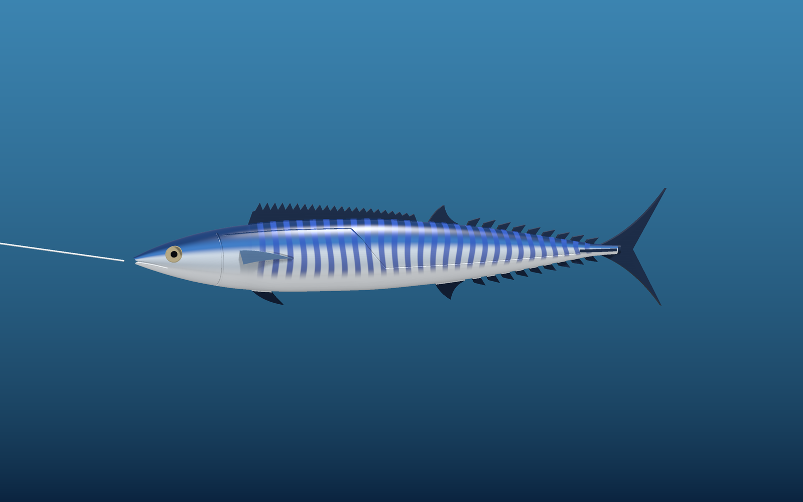

# Wahoo Teaser Decoy

A lifelike 12-inch (308 mm) wahoo (*Acanthocybium solandri*) trolling teaser, designed to be 3D printed in two flat halves and glued together.

**Live 3D viewer:** https://kuhfeldrf.github.io/wahoo/

## Print files

| File | Size | Notes |
|---|---|---|
| [`stl/wahoo_decoy_left.stl`](stl/wahoo_decoy_left.stl) | 308 × 72 × 14 mm | flat side down, no supports |
| [`stl/wahoo_decoy_right.stl`](stl/wahoo_decoy_right.stl) | 308 × 72 × 14 mm | flat side down, no supports |

Estimated ~63 g of PLA for both halves. Both files are watertight, single-body meshes in millimetres.

## Every wahoo fin is modeled

First dorsal (23 spines), second dorsal, 9 dorsal finlets, forked caudal fin, anal fin, 9 anal finlets, pelvic fins, pectoral fins, and caudal keels.

## Built-in features

- 3.5 mm tow-line channel from the nose to a belly exit
- Sealed ballast pocket (54 × 6 × 6.5 mm, up to ~20 g lead) so it rides upright
- 8 mm recesses for stick-on lure eyes
- Four holes for 1.75 mm filament alignment pins

## Assembly

1. Drop lead into the ballast pocket and filament pins into the holes.
2. Run the leader or cable through the tow channel.
3. Glue the halves with marine epoxy, clamp, and sand the seam.
4. Color it: dark cobalt back, silver sides, blue vertical bars, dark fins (paint, lure tape, vinyl, or hydro-dip).
5. Press in the eyes and seal with 2–3 coats of clear epoxy. PLA must be fully sealed for salt water.

## Source

`source/` holds the Python scripts that generate the model (`wahoo_model.py`, `wahoo_decoy.py`), the renders, and the viewer data. They use `numpy`, `scipy`, `trimesh`, `manifold3d` and `matplotlib`.
